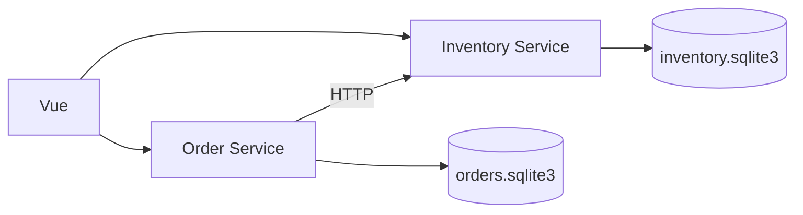

# Order Studio

[](https://github.com/ash-629/fastapi-microservice-harness/actions/workflows/ci.yml)

基于FastAPI和Vue的订单与库存应用，包含两个独立微服务，以及面向AI辅助开发的项目规范、Skills、Hooks和自动检查工具。

## 功能

- 商品与库存查询，订单创建、详情、状态筛选与分页。
- 幂等下单、原子库存占用、并发库存保护。
- 订单取消与幂等库存释放，超时后的状态恢复。
- OpenAPI契约、自动生成的TypeScript SDK、MSW与真实服务测试。
- 统一开发命令、Git暂存快照检查、代码任务检查记录和CI。

## 快速开始

需要Python 3.12+、Git，以及Node.js 20.19或22.12以上版本。uv按`.python-version`选择Python，依赖由锁文件固定。

```shell
git clone https://github.com/ash-629/fastapi-microservice-harness.git
cd fastapi-microservice-harness
python -m pip install uv
python -m uv sync --all-packages --locked
npm --prefix web ci
python -m uv run --locked harness doctor
python -m uv run --locked harness up
```

启动后访问：

|地址|用途|
|---|---|
|http://127.0.0.1:5173|应用页面|
|http://127.0.0.1:8001/docs|订单API|
|http://127.0.0.1:8002/docs|库存API|

停止：

```shell
python -m uv run --locked harness down
```

## 服务结构



每个服务拥有独立数据库。服务间通过HTTP协作，不直接访问对方数据库。数据默认保存在忽略目录`.runtime/`，首次启动初始化商品，后续启动保留已有库存和订单。

## 开发与检查

```shell
python -m uv run --locked harness task start --scope full
python -m uv run --locked harness contract generate
python -m uv run --locked harness check --scope full
python -m uv run --locked harness task finish
```

完整检查前先停止本地服务，并安装测试浏览器：

```shell
npm --prefix web exec -- playwright install chromium
```

`AGENTS.md`是项目入口，`.agents/skills/`包含功能开发、API变更和缺陷修复流程。Git Hooks检查暂存快照；Codex Hooks在显式代码任务中核对检查范围、结果和内容指纹。原生Hook需要客户端支持并信任配置。

```shell
python -m uv run --locked harness hooks install
python -m uv run --locked harness report latest
```

## 文档

- [使用示例](docs/usage.md)
- [系统架构](docs/architecture.md)
- [开发指南与命令](docs/development.md)
- [取消与库存释放](docs/cancellation.md)
- [测试说明](docs/testing.md)

## 源码归档

[Releases](https://github.com/ash-629/fastapi-microservice-harness/releases/latest)提供源码归档和SHA-256校验文件。

本地创建归档需要当前完整检查通过：

```shell
python -m uv run --locked harness package --output ../releases/OrderStudio.zip
```

归档仅包含项目文件和检查结果，不包含本机依赖、数据库、日志或Git元数据。
