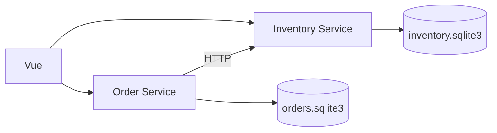

# Order Studio

[](https://github.com/ash-629/fastapi-microservice-harness/actions/workflows/ci.yml)

Java 21、Spring Boot与Vue构建的订单库存应用。两个后端服务独立运行，通过HTTP协作，配有精简的Skills、Hooks、AGENTS.md与自动检查工具。

## 功能

- 商品库存、订单创建、详情、状态筛选与分页。
- 幂等下单、并发库存保护、原子库存占用。
- 幂等取消与库存释放，响应丢失、超时和重启后的恢复。
- OpenAPI、生成的TypeScript SDK、MSW与真实服务测试。
- 分层检查、Git暂存快照、代码任务指纹和CI。

## 快速开始

需要JDK 21+和Node.js 22.12+。设置JAVA_HOME指向JDK，Maven Wrapper下载固定的Maven版本。

```shell
git clone https://github.com/ash-629/fastapi-microservice-harness.git
cd fastapi-microservice-harness
npm ci
npm ci --prefix web
node tools/harness.mjs doctor
node tools/harness.mjs up
```

首次启动编译两个可执行JAR。打开 http://127.0.0.1:5173 ，订单与库存文档分别位于 http://127.0.0.1:8001/docs 和 http://127.0.0.1:8002/docs 。停止使用node tools/harness.mjs down。

## 服务结构



Maven模块位于services。common只共享JSON校验、请求关联和数据库事务工具。每个服务拥有独立数据库，数据保存在忽略目录.runtime，重启保留已有订单和库存。

## 开发与检查

```shell
node tools/harness.mjs task start --scope full
node tools/harness.mjs contract generate
node tools/harness.mjs down
npm --prefix web exec -- playwright install chromium
node tools/harness.mjs check --scope full
node tools/harness.mjs task finish
```

接口变化后先用Maven Wrapper重新编译，再生成契约和SDK。完整检查包含Java测试、Node工具与真实HTTP测试、契约差异、前端构建及Playwright。

```shell
node tools/harness.mjs hooks install
node tools/harness.mjs report latest
```

Git Hooks验证暂存快照和推送前检查；Codex Hooks在显式代码任务中核对检查范围和内容指纹。原生事件需要客户端支持并信任配置。

## 文档

- [使用示例](docs/usage.md)
- [系统架构](docs/architecture.md)
- [开发指南](docs/development.md)
- [取消与库存释放](docs/cancellation.md)
- [测试说明](docs/testing.md)
- [Java后端设计](docs/plans/java-backend.md)

## 源码归档

完整检查通过后运行：

```shell
node tools/harness.mjs package --output ../releases/OrderStudio-Java.zip
```

归档包含源码和当前检查结果，排除依赖、JDK、数据库、日志、构建目录和Git元数据。[Releases](https://github.com/ash-629/fastapi-microservice-harness/releases/latest)提供源码和SHA-256文件。
