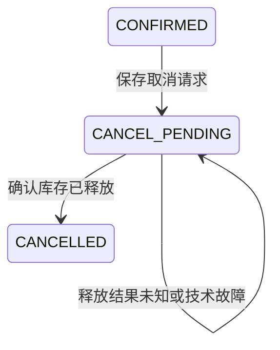

# 订单取消与库存释放

## 状态

仅CONFIRMED订单可以首次申请取消。PENDING_INVENTORY和REJECTED返回409；未知订单返回404。CANCEL_PENDING与CANCELLED接受重复操作。

## 接口

|接口|请求|响应|
|---|---|---|
|POST /api/v1/orders/{order_id}/cancel|无请求体；订单ID标识取消操作|完成或重放200；待确认202；错误404/409/422/503|
|PUT /internal/v1/reservations/{order_id}/release|原商品ID和数量|成功或重放200 RELEASED；不存在404；冲突或不可释放409|

202响应包含Location和Retry-After。客户端只在服务确认释放后显示“已取消”。

## 两个事务边界

Order先在本地事务中将CONFIRMED改为CANCEL_PENDING，记录cancel_requested_at并提交，然后调用Inventory。

Inventory在单个写事务中验证原请求摘要、加回库存并将RESERVED改为RELEASED。重复release与迟到reserve均重放RELEASED，不再修改库存。

Order严格校验返回的状态、订单ID、商品ID和数量，再条件更新CANCEL_PENDING为CANCELLED并记录cancelled_at。网络调用期间不持有本地写事务。

## 未知结果与恢复

释放可能已提交但响应丢失。此时Order保留CANCEL_PENDING，使用相同订单ID重试release，而不是推断失败或重新加回库存。

后台任务扫描到期的PENDING_INVENTORY和CANCEL_PENDING记录。技术失败采用有界退避；五次失败后设置needs_attention并保留处理中。再次调用取消接口或显式reconcile可以继续处理。

条件状态更新避免迟到响应覆盖终态。重复取消不重置原取消时间，也不修改已完成的cancelled_at。

## 数据库升级

Order的schema版本0→1在事务内增加两个可空字段：cancel_requested_at与cancelled_at。旧订单保留，初始化可重复执行。更高的未知schema版本会拒绝启动。

## 消费者同步

公开订单模型包含CANCEL_PENDING/CANCELLED，库存模型包含RELEASED。修改接口模型后需重新生成OpenAPI与TypeScript SDK，并同步页面、Mock和测试。

相关测试位于`tests/test_cancellation.py`、`tests/test_integration.py`以及`web/tests/cancellation.spec.ts`。
