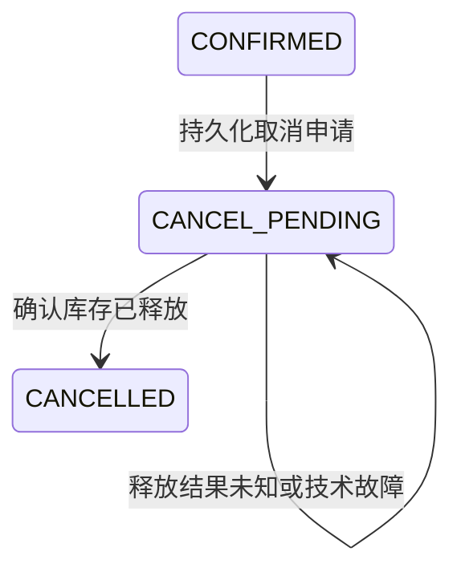

# 取消订单：一次可回放的真实迭代

## 结果与边界

基于已通过验收的v1.1基线1541caf，增加了取消订单、幂等释放库存、故障恢复、前端状态与筛选，并同步契约、SDK、Mock和测试。

只允许已确认订单发起取消。处理中和已拒绝订单返回409；不存在的订单404。重复取消、重复释放不会重复加回库存。未确认释放结果时，订单保持CANCEL_PENDING，不显示“已取消”。

本次在当前会话真实使用了项目feature-delivery和api-change流程；未自动创建新会话或子Agent。原生Codex Hook信任/事件分发、远端CI仍需目标环境验证，不能把适配器协议测试说成原生事件已启用。

## 业务状态与协议



Inventory在单个写事务中校验原请求摘要、增加库存、将占用改为RELEASED。之后的release重放或迟到reserve均重放RELEASED，不再次修改库存。

Order在事务内将CONFIRMED改为CANCEL_PENDING并提交，然后调用库存。只接受严格校验且匹配原订单的RELEASED结果，再条件更新为CANCELLED。后台扫描和显式reconcile同时处理下单与取消两类处理中状态；五次技术失败标needs_attention，保留处理中，允许显式重试。

|接口|请求|响应|
|---|---|---|
|POST /api/v1/orders/{order_id}/cancel|无请求体；操作身份为订单ID|完成/重放200；结果未知202，含Location与Retry-After；404/409/422/503统一错误|
|PUT /internal/v1/reservations/{order_id}/release|原商品ID和数量|首次与重放200 RELEASED；不存在404，不可释放或请求冲突409|

新增Order状态为CANCEL_PENDING/CANCELLED；新增可空cancel_requested_at/cancelled_at；库存记录增加RELEASED。Order库通过事务内schema版本0→1添加字段，保留旧行。前端、Mock及内部客户端作为同版本消费者一起升级。

## 实际过程

1. 停止演示进程，保存源码快照与SQLite一致性备份，建立基线提交1541caf。
2. 在[任务验收表](../tasks/cancel-order.md)中明确C01–C07，先增加测试。基线8个新增测试失败，确认功能确实尚不存在。
3. 先修改接口模型和路由，再生成OpenAPI与SDK。前端构建报告状态标签缺少CANCEL_PENDING/CANCELLED，暴露消费者尚未更新。
4. 实现事务、释放幂等、恢复与旧库升级，同步页面、Mock与中文错误。最初8个测试转为通过，再增加并发、错误响应、重试耗尽、真实HTTP和浏览器测试。
5. 显式代码任务开启后，在缺少当前有效检查时调用Stop适配器，得到block续跑反馈。这里是适配器真实进程协议调用，不是原生事件分发证明。
6. 全量检查通过：54个Python测试，13个Playwright用例（11个浏览器场景、2个MSW协议用例）。类型、格式、契约与SDK、暂存快照等检查同时执行。
7. 将基线Git源码归档解压到独立目录，仅应用本次补丁，再重新安装Python和前端依赖，执行全量检查验证可回放：54项Python、13项前端用例通过，受影响组件逐文件文本一致。

原始记录保存在`.harness/iterations/cancel-order`。源补丁见[cancel-order.patch](cancel-order.patch)，只包含services/contracts/web/tests，文档不混入功能补丁。

## 在本地Git仓库查看差异

```powershell
git log --oneline
git diff 1541caf HEAD -- services contracts web tests
```

基线和功能提交均为本地提交，没有推送。ZIP不包含.git；交付包另带iteration/baseline.zip和功能补丁，便于无Git历史时重建。

## 从交付包回放

1. 将`iteration/baseline.zip`解压到新的空目录；不要覆盖运行中的项目。
2. 在解压目录执行以下命令。`<补丁绝对路径>`替换为交付包中iteration/cancel-order.patch的位置。

```powershell
git init
git apply --check "<补丁绝对路径>"
git apply "<补丁绝对路径>"
python -m pip install uv
python -m uv sync --all-packages --locked
npm --prefix web ci
npm --prefix web exec -- playwright install chromium
python -m uv run --locked harness check --scope full
```

回放补丁只恢复功能和测试，README等仍为基线版本，说明应以本文为准。full测试使用独立数据库和临时进程，需要8001/8002/5173端口空闲；先停止手工演示进程。

## 面试演示顺序

先展示基线→新增验收→契约引发的消费者编译错误，再展示补丁和最终测试。界面上创建订单，看到库存减少，再从详情取消，确认库存加回。随后展示释放响应丢失和重启恢复测试，说明为什么处理中不能提前显示取消成功。

新会话接手可粘贴：

> 读取AGENTS.md、docs/tasks/cancel-order.md与docs/iterations/cancel-order.md。核对当前代码和有效检查证据，说明取消流程的两个事务边界、未知结果如何恢复，以及哪些验证仍依赖目标环境。不要直接假定上一会话已完成所有验证。

独立回放验收run_id：19f49fef-f863-44cb-95e9-b7b0ab0fe59f，耗时44.95秒；该耗时不包含依赖安装。
